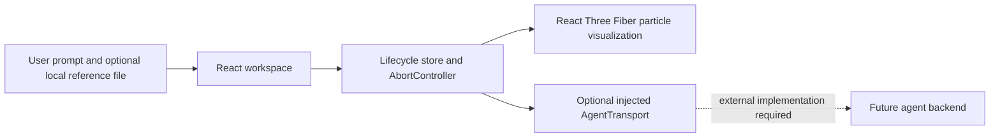

# Forma — Agent Interface Prototype

A React and TypeScript workspace that visualizes an agent's lifecycle with a Three.js particle orb. It provides a frontend transport interface for a future backend. The default application does not call an AI service.

## Contributions and provenance

The original source has one commit attributed to “Forma Site.” It contains the particle renderer, workspace UI, lifecycle store, and transport interface. This demonstrates AI-assisted interface work; repository evidence does not independently establish the owner's personal authorship or publication rights. Confirm ownership before release.

## Technology and structure

React 19, TypeScript 5.7, Vite 6, Three.js, React Three Fiber, and Lucide icons. `src/agent.ts` provides lifecycle state and cancellation; other `src/` components implement the workspace and orb. No database, API server, queue, or model SDK is present.

## Architecture



## Features

**Implemented and verified:** `npm ci` and `npm run build` pass, including TypeScript compilation and Vite bundling on Node 24.22.3. Source implements five lifecycle states, transport cancellation, and suppression of late events after cancellation.

**Implemented but not fully tested:** WebGL appearance, reduced-motion behavior, file-reference handling, recovery actions, and interaction behavior in a real browser during this review. No automated test suite is supplied.

**Planned or experimental:** connecting a real agent backend. The state controls preview visualizations; they are not evidence of real tool execution.

## Installation and setup

Use Node.js 22+.

```bash
npm ci
npm run dev
npm run build
```

Open the URL printed by Vite. `npm run preview` serves the build. No environment variables or API keys are needed for the current interface; `.env.example` records that fact.

## Agent integration

Import `agent` from `src/agent.ts` and call `agent.connect(adapter)`. An adapter implements `submit(prompt, emit, signal, context)` and may implement `recover()`. Emit actual `idle`, `thinking`, `executing`, `success`, or `blocked` events from your backend. Honor the AbortSignal. Context contains the selected mode and an optional browser `File`; the adapter decides how to use it. No files are uploaded by the default interface. Keep provider secrets on a server.

Submitting without an adapter produces an explicit connection blocker. Transport errors become blocked state. New tasks abort the current request, and late emitted events are ignored. No model, permissions executor, retrieval service, evaluation pipeline, or fallback provider is configured.

## Engineering considerations

The orb uses a single draw call for 3,500 shader-based particles, caps pixel ratio at 2, clamps frame delta, and supports reduced motion. Status text and recovery controls exist independently of WebGL. History is session-only. These are implementation observations; performance and accessibility have not been benchmarked in this review.

## Current status, demonstration, and limitations

Frontend prototype. [Original Sites preview](https://forma-agent-studio.lj-faderon.chatgpt.site) is owner-restricted according to current metadata; recruiters may not be able to open it. No audience was changed. No screenshots were captured. The build warns about a large Three.js chunk. No working production agent backend, authentication, durable persistence, or deployment reliability is demonstrated.
